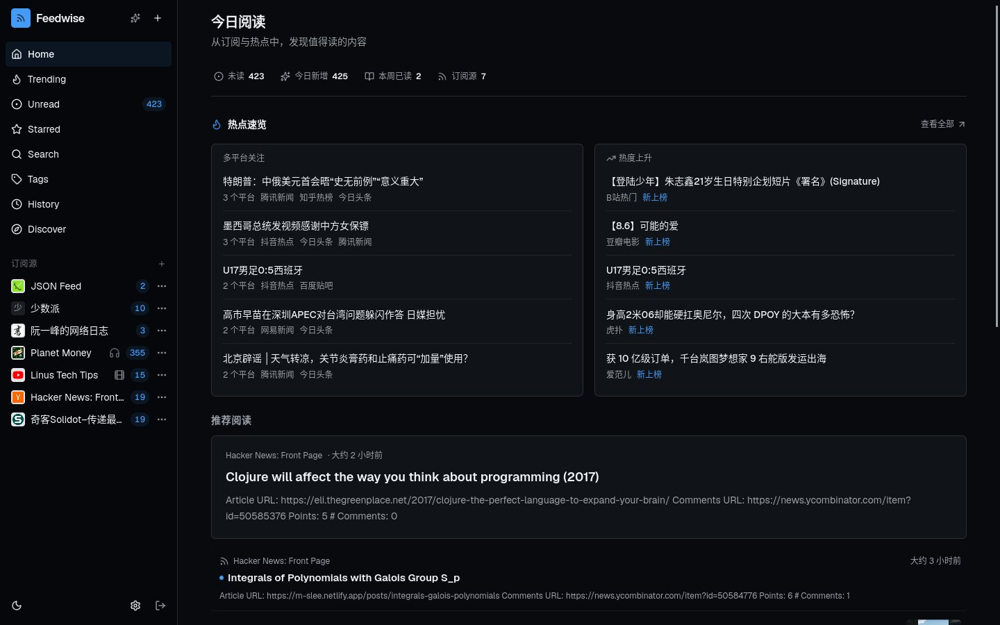
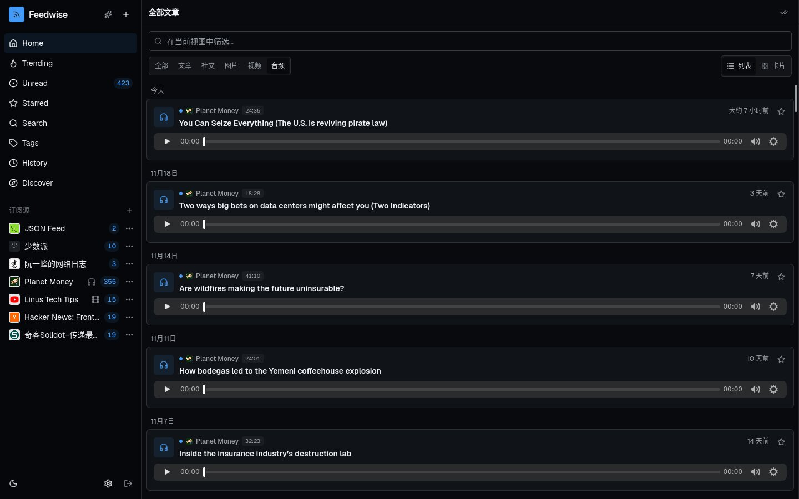
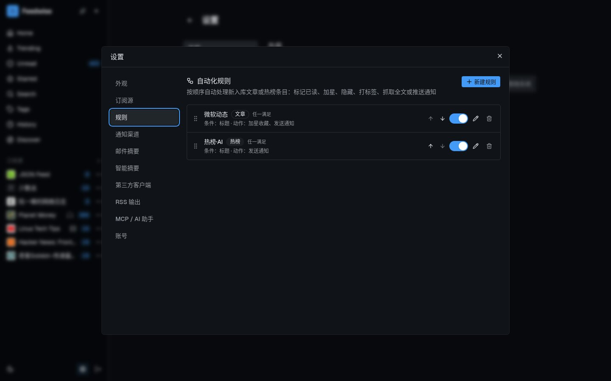

# Feedwise

自托管的全网信息收集平台。把 RSS、RSSHub 路由、22+ 平台热榜和任意网页汇成一条信息流，在你自己的服务器上完成去重、筛选、推送和再输出。


## 功能

**采集**
- RSS 2.0 / Atom / RDF / JSON Feed，OPML 导入导出
- RSSHub 路由发现页，一键订阅
- 任意网页：用 CSS 选择器把页面变成订阅源，保存前可预览
- 热榜：DailyHotApi 或 newsnow，排名变化、新上榜与跨平台事件
- 抓取讲礼貌：ETag / Last-Modified 条件请求，遵守 `Cache-Control` 与 `Retry-After`，按订阅源发布节奏自适应轮询（15 分钟–24 小时），失败退避，单站点并发限制

**阅读**
- 三栏阅读器，虚拟化长列表，`j` / `k` / `s` / `m` / `o` 快捷键，SSE 实时更新
- 按内容类型自动分视图：文章、社交、图片、视频、音频，可按订阅覆盖
- Readability 全文提取（手动或按订阅自动），SimHash「相关报道」
- 中日韩全文搜索（二元切分建索引），`-词` 排除

| 首页 | 视频视图 | 音频视图 |
| --- | --- | --- |
|  |  |  |

**规则与推送**
- 规则按标题、正文、作者、链接、订阅源、文件夹匹配（包含 / 正则 / 等于…），对新文章执行标记已读、加星、隐藏、打标签、抓全文、通知
- 热榜规则：关键词上榜即提醒，同一条目只提醒一次
- 通知渠道：Webhook（HMAC 签名）、Telegram、Bark、ntfy、飞书、钉钉、企业微信、浏览器推送（PWA）



**开放**
- Google Reader API / Fever API：Reeder、NetNewsWire、Read You、FeedMe、Fluent Reader 等客户端直连
- 任意筛选条件发布为公开 RSS 链接
- MCP：stdio 与带 OAuth 2.1 的 HTTP 端点，接入 Claude、Cursor 等 AI 助手

**AI（可选，自带 OpenAI 兼容 Key）**：文章摘要与重要度、自动打标签、AI 搜索、每日邮件简报。

**安全**：所有抓取用户或订阅源提供 URL 的服务端请求在连接时拒绝内网、回环和链路本地地址，逐跳校验重定向并限制大小与时间；敏感配置加密存储。

## 快速开始

需要 Node.js 20.18+、PostgreSQL 14+（推荐 16）、Redis、pnpm。

```bash
pnpm install

cp .env.example .env
# 填写 DATABASE_URL、REDIS_URL、BETTER_AUTH_SECRET、BETTER_AUTH_URL、NEXT_PUBLIC_APP_URL
node -e "console.log('ENCRYPTION_KEY=' + require('crypto').randomBytes(32).toString('base64'))" >> .env

# 建表 / 升级。必须用迁移：搜索依赖只在迁移中创建的 SQL 函数
pnpm db:migrate

# 已有明文 SMTP/LLM 密钥时执行一次（可重复执行）
pnpm db:encrypt-secrets

# 开发服务器 + 后台 worker
pnpm dev:all
```

打开 http://localhost:3000 注册账号后添加订阅。本机或局域网内的订阅源会被 SSRF 防护拒绝，开发时可在 `.env` 设置 `ALLOW_PRIVATE_NETWORK_FETCH=1`。

### 脚本

| 命令 | 说明 |
| --- | --- |
| `pnpm dev` | Next.js 开发服务器 |
| `pnpm worker` | 后台 worker（订阅、热榜、全文、通知、邮件简报） |
| `pnpm dev:all` | 同时启动以上两者 |
| `pnpm build` / `pnpm start` | 生产构建 / 启动 |
| `pnpm mcp` | stdio MCP 服务（以 `FEEDWISE_USER_EMAIL` 身份） |
| `pnpm db:generate` / `pnpm db:migrate` | 生成 / 执行迁移 |
| `pnpm db:encrypt-secrets` | 一次性加密旧的明文密钥 |

## Docker 部署

`docker-compose.yml` 包含 PostgreSQL、Redis、DailyHotApi（仅内网访问）、一次性迁移任务、Web 应用和 worker。按 `.env.example` 末尾的 Compose 变量配置后：

```bash
docker compose up -d
```

worker 可以水平扩容：订阅调度用 `FOR UPDATE SKIP LOCKED` 认领，周期任务是 BullMQ Job Scheduler。

### 浏览器推送

生成一次 VAPID 密钥（`npx web-push generate-vapid-keys`），为 Web 和 worker 同时设置 `VAPID_PUBLIC_KEY`、`VAPID_PRIVATE_KEY`、`VAPID_SUBJECT`，然后在「设置 → 通知渠道」为每台设备启用。

## 第三方客户端

在「设置 → 第三方客户端」设置独立的 API 密码（不是登录密码），用户名为邮箱：

- Google Reader API：`<站点地址>/api/greader`
- Fever API：`<站点地址>/api/fever`

修改或撤销 API 密码会让所有客户端重新登录。

## RSS 输出

「设置 → RSS 输出」可把任意筛选（订阅源、文件夹、标签、星标、视图）发布为不可猜测的公开 RSS 2.0 链接，重置链接即可作废旧地址。

## MCP

- HTTP：`<站点地址>/api/mcp`，OAuth 2.1 动态注册 + PKCE，在 Claude、Cursor 中添加为远程 MCP 服务器
- stdio：`FEEDWISE_USER_EMAIL=you@example.com pnpm mcp`

工具：`search_articles`、`list_articles`、`get_article`、`mark_articles`、`list_feeds`、`subscribe_feed`、`hot_boards`、`hot_trending`、`related_coverage`。

## 热榜

热榜独立于 RSS 文章，不写入文章表、不影响未读数。

- 上游由 `HOT_API_PROVIDER` 选择：`dailyhot`（默认，[DailyHotApi](https://github.com/imsyy/DailyHotApi)）或 `newsnow`（[newsnow](https://github.com/newsnext/newsnow)），地址为 `HOT_API_URL`；newsnow 未提供的榜单显示明确错误。
- worker 每 5 分钟检查一次，默认 20 分钟刷新、最低 10 分钟，连续失败按 2、4、8 倍退避；快照和 14 天未出现的条目自动清理。
- 某个源暂时不可用时保留最后成功的榜单，其他源照常更新。跨平台事件按标题相似度聚类，属启发式结果。

## 技术栈

Next.js 16 · React 19 · Tailwind CSS 4 · shadcn/ui（Base UI）· TanStack Query / Virtual · Drizzle ORM · PostgreSQL · BullMQ + Redis · Better Auth · feedsmith · linkedom · Mozilla Readability

## License

MIT
